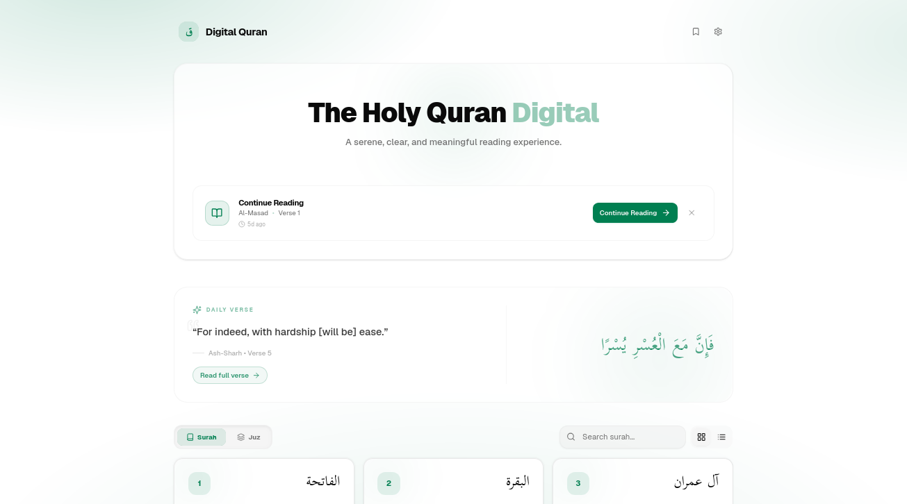
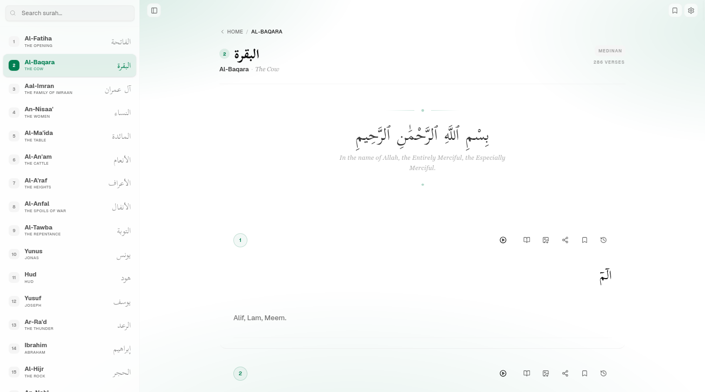
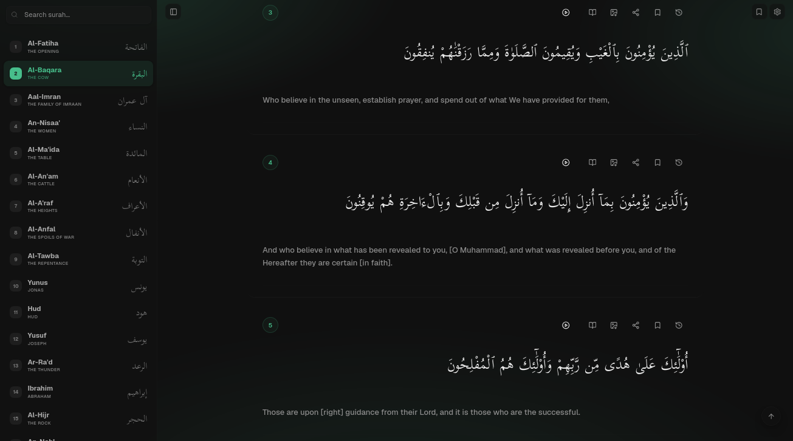
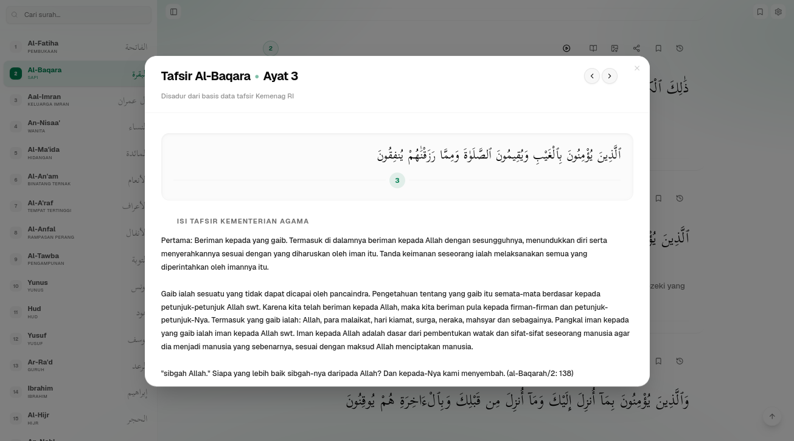
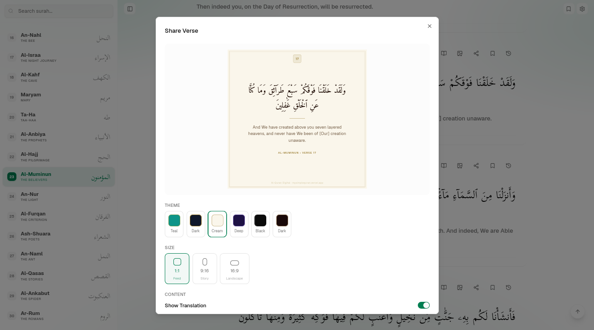
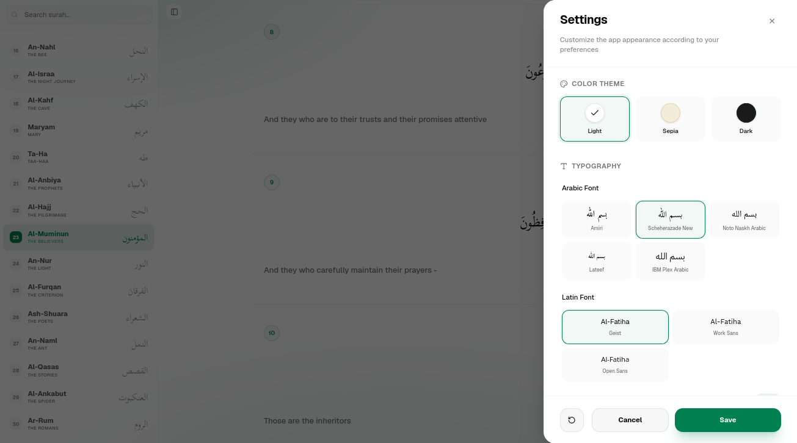
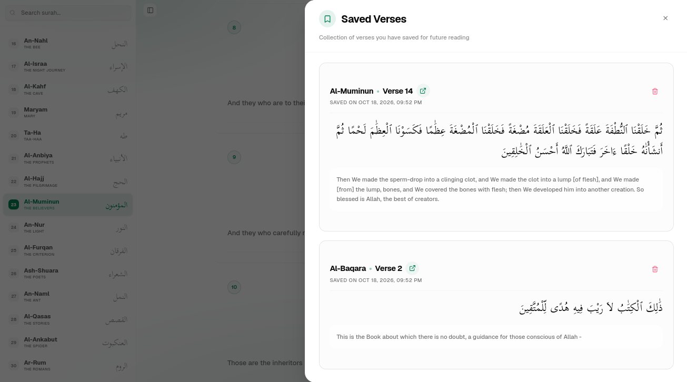
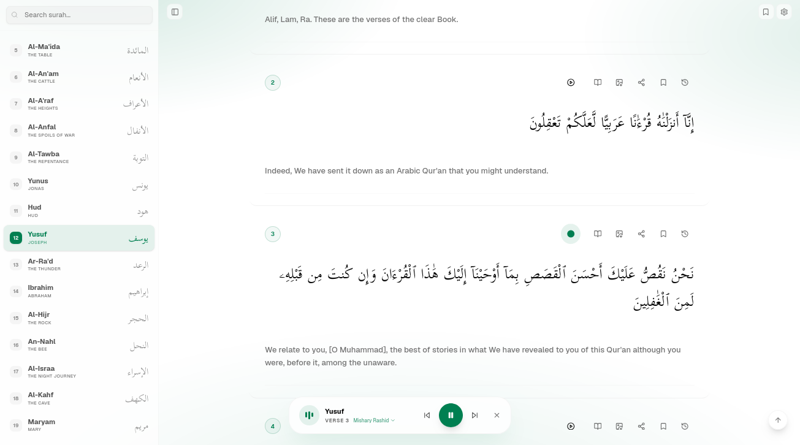
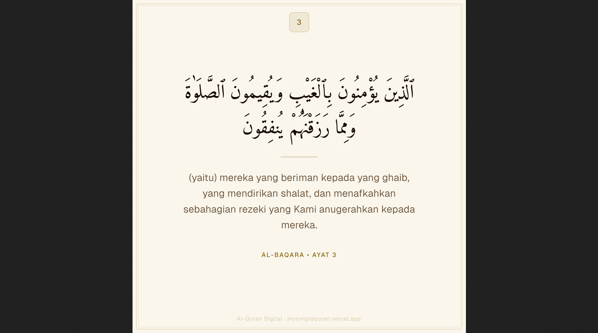
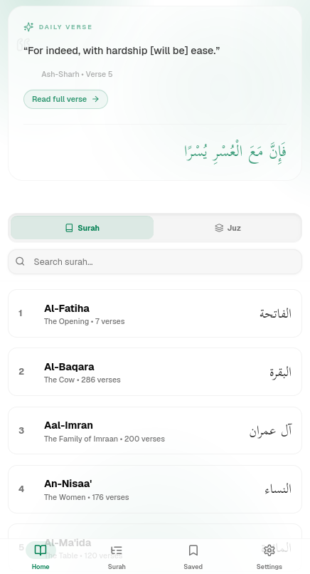

# Al-Quran Digital 📖

A minimalist Quran reader built for long, focused reciting sessions: uninterrupted verse flow, elegant Arabic typography, and a quiet interface that stays out of the way.

🌐 **Live Demo:** [mysimplequran.vercel.app](https://mysimplequran.vercel.app)

> This project was initially scaffolded with **Vercel v0** and has since been reworked and extended with the help of AI coding agents.

<p align="center">
  
</p>

---

## Screenshots

<table>
  <tr>
    <td width="50%"></td>
    <td width="50%"></td>
  </tr>
  <tr>
    <td align="center"><sub><b>Reader — light</b> — collapsible sidebar, verse actions, continuous flow</sub></td>
    <td align="center"><sub><b>Reader — dark</b> — the same layout in the dark theme</sub></td>
  </tr>
  <tr>
    <td></td>
    <td></td>
  </tr>
  <tr>
    <td align="center"><sub><b>Tafsir</b> — Kemenag commentary per verse</sub></td>
    <td align="center"><sub><b>Export</b> — 6 card themes, 3 aspect ratios</sub></td>
  </tr>
  <tr>
    <td></td>
    <td></td>
  </tr>
  <tr>
    <td align="center"><sub><b>Settings</b> — theme, fonts, sizes, language</sub></td>
    <td align="center"><sub><b>Saved verses</b> — bookmarked verses with translation</sub></td>
  </tr>
  <tr>
    <td></td>
    <td></td>
  </tr>
  <tr>
    <td align="center"><sub><b>Audio</b> — floating murottal player</sub></td>
    <td align="center"><sub><b>Share</b> — exporting a verse as an image</sub></td>
  </tr>
  <tr>
    <td colspan="2" align="center"></td>
  </tr>
  <tr>
    <td colspan="2" align="center"><sub><b>Mobile</b> — portrait layout with bottom navigation</sub></td>
  </tr>
</table>

---

## Key Features

**Reading**
- Continuous verse-to-verse layout: no boxes or dividers interrupting the recitation.
- All 114 surahs plus a 30-juz index, with previous/next surah navigation.
- Filter the surah list by name or number, straight from the reader sidebar.

**Meaning**
- Indonesian (Kemenag) and English (Saheeh International) translations alongside the Arabic text, switchable in settings.
- Official **Kemenag** tafsir for every verse (6,236 verses covered), with prev/next navigation inside the commentary. The tafsir is Indonesian-only; when the interface is in English, the dialog says so explicitly.

**Audio**
- Verse-level murottal by **Mishary Rashid Alafasy**, with a floating player and auto-advance to the next verse.

**Sharing**
- Export a verse as a retina image: 6 card themes (teal, navy, cream, purple, black, rose) and 3 aspect ratios (1:1, 9:16, 16:9).
- Share as text to WhatsApp, X/Twitter, Facebook, or copy to clipboard.

**Personalization**
- Light, Dark, and Sepia themes.
- 5 Arabic typefaces (Amiri, Scheherazade New, Noto Naskh Arabic, Lateef, IBM Plex Sans Arabic) and 3 Latin typefaces.
- Independent Arabic/translation font sizes, plus toggles to hide either layer.
- Indonesian/English interface language covering the whole UI: menus, tooltips, settings, search, and saved verses. Saved verses keep both translations, so switching language re-renders them instead of showing the language they were saved in.

**Progress and privacy**
- “Mark last read” on any verse; the home screen then offers **Continue Reading** where you stopped.
- Saved-verses collection stored locally.
- Everything (bookmarks, settings, language) lives in `localStorage` — no accounts, no server-side tracking. The only outbound requests are audio files (everyayah.com) and, when you search translations, the public alquran.cloud API.

**Offline**
- Installable PWA. Reader pages are precached by the service worker; tafsir is cached after the first open.

---

## Tech Stack

- **[Next.js 16](https://nextjs.org/)** (App Router, statically generated surah pages)
- **[React 19](https://react.dev/)** + **TypeScript**
- **[Tailwind CSS 4](https://tailwindcss.com/)**
- **[Radix UI](https://www.radix-ui.com/)** primitives, shadcn-style components
- **[next-themes](https://github.com/pacocoursey/next-themes)** for light/dark/sepia
- **[Serwist](https://serwist.pages.dev/)** for the service worker and offline support
- **[html-to-image](https://github.com/bubkoo/html-to-image)** for offline, retina-quality verse export
- **[Lucide](https://lucide.dev/)** icons

---

## Performance Notes

Measured on a production build (`pnpm build`), gzip transfer sizes:

| What | Result |
| --- | --- |
| Surah page HTML (Al-Baqarah, 286 verses) | **207 KB gz** (4.37 MB → 2.99 MB raw since tafsir was extracted) |
| RSC payload per surah (prefetch/navigation) | **95 KB gz**, down from 476 KB |
| All 114 surah HTML pages | 5.2 MB gz total |
| Tafsir | Loaded on demand from `/data/tafsir/{surah}.json`, never part of the page payload |

How it stays small:

- Tafsir is generated at build time into per-surah JSON files and fetched only when a reader opens the commentary dialog.
- Tafsir and share/export dialogs are code-split and mounted on first open (`next/dynamic`), keeping `html-to-image` out of the initial bundle.
- `content-visibility: auto` on verse cards skips layout/paint for off-screen verses.
- Surah links in long lists opt out of route prefetching, so browsing the index does not download unread surahs in the background.

> These are transfer-size measurements, not Lighthouse scores. Core Web Vitals vary by device and network.

---

## Project Structure

```
app/                 App Router pages, layout, sitemap, robots, manifest, service worker source
components/          Reader shell, verse card, modals, export/share UI, shadcn-style primitives
hooks/               Settings, language, audio, toast, mobile detection
lib/                 Data access, tafsir loader, fonts, qari config, storage helpers, site constants
data/quran.json      Surah index (names, translations, ayah counts)
data/surah/*.json    Verse text, translations, audio URLs, and the Kemenag tafsir
scripts/             Build-time generators (tafsir → static JSON)
public/data/tafsir/  Generated per-surah tafsir (gitignored)
```

---

## Getting Started

**Prerequisites:** Node.js 20+ and [pnpm](https://pnpm.io/).

```bash
git clone https://github.com/gper00/minimalist-quran.git
cd minimalist-quran
pnpm install
pnpm dev
```

Open [http://localhost:3000](http://localhost:3000).

`dev` and `build` first run `scripts/build-tafsir.mjs`, which extracts the tafsir from `data/surah/*.json` into `public/data/tafsir/`. That folder is generated and intentionally not committed.

**Production build**

```bash
pnpm build
pnpm start
```

---

## Data & Credits

All Quran content is bundled as JSON in `data/`: `quran.json` holds the surah index, and `data/surah/{number}.json` holds the verses, translations, recitation URLs, and tafsir for one surah. Tafsir is split into `public/data/tafsir/` at build time.

| Content | Source |
| --- | --- |
| Arabic text | Quran text in the Uthmani script, as published in the bundled dataset |
| Indonesian translation | **Kemenag** (Ministry of Religious Affairs of the Republic of Indonesia) |
| English translation | **Saheeh International** |
| Tafsir | **Kemenag RI**, *Aplikasi Quran Kementerian Agama Republik Indonesia* — Indonesian only |
| Recitation | [everyayah.com](https://everyayah.com/) — Mishary Rashid Alafasy, 128 kbps murattal |
| Verse search | [alquran.cloud](https://alquran.cloud/) public API (`id.indonesian` / `en.asad` editions), queried at runtime |

Please keep these credits when redistributing the data, and verify the terms of each upstream source before commercial use.

---

## Deployment

The app is statically rendered and deploys as-is on Vercel (or any Node host). The service worker is regenerated by `pnpm build`.

---

## Unrestricted Distribution

This project is an open contribution to the community and carries **no licensing restrictions** (public domain). You are free to copy, modify, redistribute, or rebuild it into your own application, with no attribution required.

The only ask is to preserve the data credits above and to keep the Quranic text and tafsir accurate if you modify them.

---

## Contact

Crafted with dedication by [**Umam Alfarizi**](https://umamalfarizi.is-a.dev)
